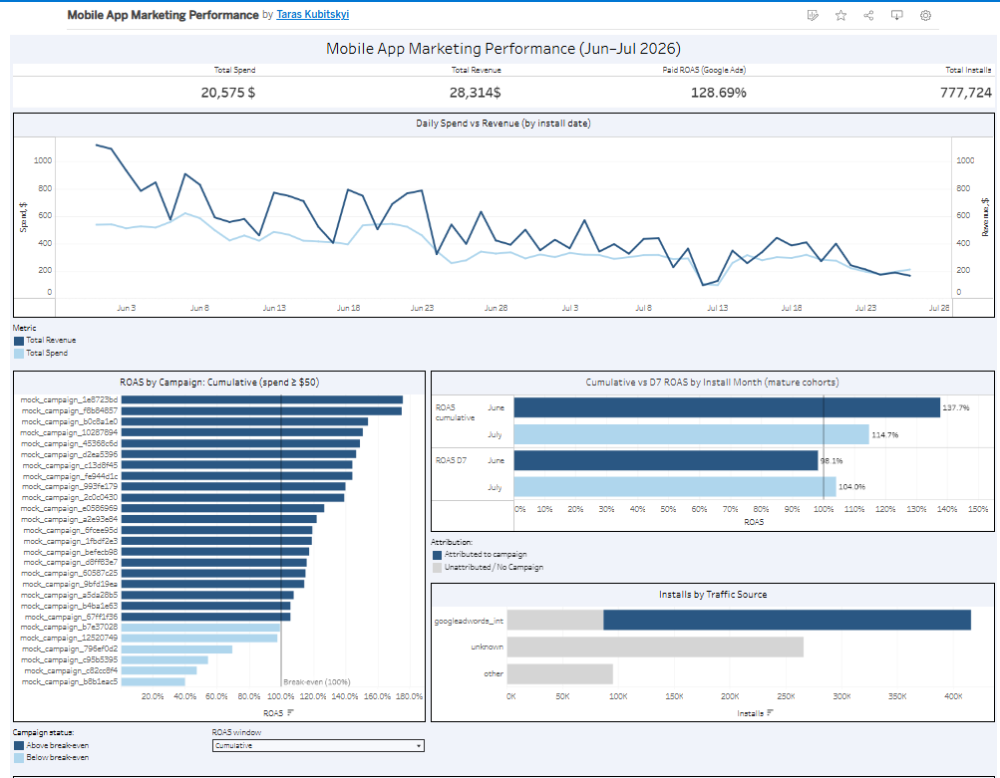

# 📱 Mobile App Marketing Mart & Campaign ROAS | BigQuery SQL + Tableau

**[▶ Open the Tableau dashboard](https://public.tableau.com/app/profile/taras.kubitskyi/viz/MobileAppMarketingPerformance/Dashboard)** · **[SQL](marketing_mart.sql)** · **[Mart CSV](marketing_mart.csv)**

*Take-home assignment for a Junior Data Analyst role, anonymized and published with the company's permission. The data is mock data.*

## 🔍 Project Overview

A mobile app acquires users through paid and other channels. The goal was to build a single marketing mart from four raw sources in BigQuery and a Tableau dashboard that answers one question: **which campaigns pay back their ad spend, and which do not?**

Period: June – July 2026 (data ends on 26 July).

## 🗄 Data

| Source | Grain | Rows |
|---|---|---|
| `non_org_installs_report` | one install event | 777,724 |
| `cost_table` | spend pre-aggregated by date, campaign, ad set and geo | 5,253,424 |
| `ad_revenue_raw` | one in-app ad impression with revenue | 5,955,170 |
| `in_app_events_report` | one subscription funnel event | 24,963 |

Join key: `app_id + media_source + campaign_id` (same data type in all four tables).

## ⚙️ What I Did

1. **Aggregated each source separately before joining.** `cost_table` still has thousands of rows per campaign-day (ad set × geo), so a direct join to event tables would multiply the numbers.
2. Checked how revenue is recorded before summing it. Only 4 of 10 in-app event types carry revenue; the rest (trials, cancellations, billing retries) have NULL, and refunds are already negative. So a plain SUM gives net revenue (new subscriptions + renewals − refunds) without filtering by event name.
3. **Cohort revenue attribution.** All revenue (ads and in-app purchases) is attributed to the user's **install date** and campaign, so spend on a day is compared with what the users acquired that day eventually brought in.
4. **Kept unattributed traffic visible.** Missing `campaign_id` is kept as `-1 / Unattributed` instead of being dropped, so mart totals match the raw tables.
5. **D7 / D30 revenue windows with cohort maturity flags,** so campaigns of different age can be compared fairly.
6. **Validated the mart against the raw tables:** install count, spend after EUR → USD conversion (via `cost_usd`), duplicate installs per device, and that `campaign_id` really overlaps between spend and event tables.
7. **Tableau dashboard:** KPIs, daily spend vs revenue, campaign ROAS with a Cumulative / D7 switch, cumulative vs D7 ROAS by install month, and installs by traffic source.

## 📈 Key Findings

- **Spend data exists only for Google Ads,** so ROAS can be calculated only for that channel. Revenue from `other`, `unknown` and unattributed Google traffic ($1,836) has no matching spend and is excluded from ROAS.
- **Paid ROAS is 128.7%** ($20,575 spend). Including revenue without spend would inflate it to 137.6%.
- **~58% of installs are not attributed to any campaign,** a large blind spot worth investigating (attribution setup, self-attributing networks).
- **Campaigns differ widely:** cumulative ROAS ranges from 40% to 176% across 27 campaigns with at least $50 spend; 6 are below break-even.
- **Cumulative ROAS is misleading when cohorts have different ages.** June cohorts look much better than July (138% vs 115%) only because their users had more time to generate revenue. Within the same 7-day window, July performs at least as well (104% vs 98%).
- **On a 7-day horizon, paid traffic roughly breaks even,** and the campaign ranking changes noticeably: 14 of 27 campaigns have not paid back within the first week. For example, a campaign with 154% cumulative ROAS has only 65% D7 ROAS, because its users had almost two months to accumulate revenue.

## 🔁 What I Checked and Fixed

- **Overall ROAS on the dashboard was inflated** (137.6%): it divided revenue from all sources by spend that exists only for Google Ads. Fixed to compare only rows with spend data (128.7%).
- **The data ends on 26 July**, not 31 July: the last days had zero spend, revenue and installs, so they are excluded instead of looking like a sudden drop.
- **Refunds outside the revenue window:** in 6 of 1,972 rows, D7 revenue is higher than all-time revenue. Refunds are negative events, and when a refund happens after day 7, the D7 window sees the purchase but not the refund. Early ROAS windows are optimistic by construction.
- **Duplicate installs are minimal:** 97.2% of devices installed the app once, so `COUNT(*)` is a valid install count. 37% of installs have no device ID, which is documented as a limitation.

## ⚠️ Limitations

- ROAS only for Google Ads; no spend data for other sources.
- Two months of data: only cohorts installed up to ~26 June have a complete D30 window.
- Mock data, so absolute values are illustrative; the methodology is the point.

## 🛠 Stack

`SQL` · `Google BigQuery` · `Tableau`
